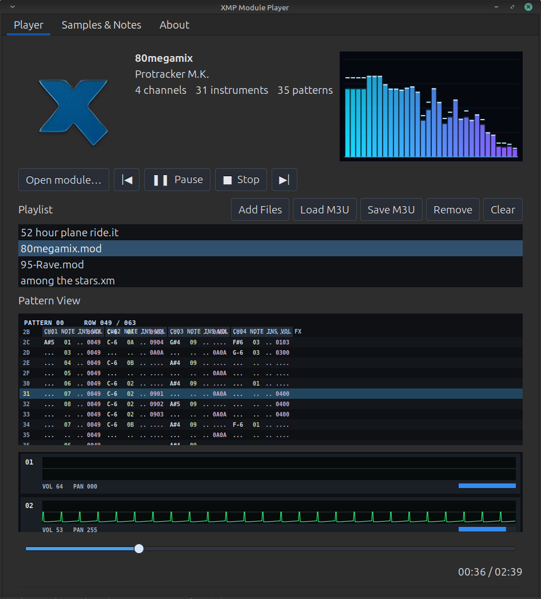

# XMP Module Player

A native Linux music player built with **GTK3, SDL2, libxmp, and FFmpeg**.

XMP Module Player brings classic tracker music and regular audio playback to the Linux desktop, with a graphical interface, real-time audio visualization, and detailed module and sample information.



## Features

- 🎵 **Tracker module playback** powered by libxmp
- 🎧 **Regular audio playback** powered by FFmpeg: MP3, WAV, M4A/AAC, Ogg Vorbis, Opus, and FLAC
- 🎵 **Commodore 64 SID playback** powered by libsidplayfp
- 🎹 **MIDI playback** powered by FluidSynth, with user-selectable SF2/SF3 SoundFonts
- 🎼 **SoundFont manager** with multi-file import, folder scanning, live switching, and a startup default
- 🎵 **ZX Spectrum AY/YM playback** through bundled ZXTune, including PT3, AY, VTX, YM, STC, and SQT
- 💾 **Offline WAV export** for supported audio formats, with cancellation and overwrite confirmation
- 🎚️ **Playback controls** with seeking and track timing
- 📃 **Playlist management** with add, remove, clear, and drag-and-drop support
- 📃 **High Voltage SID Collection (HVSC) browsing and integrated downloader**
- 🔁 **Automatic track advancement**
- 📂 **M3U playlist loading and saving**
- 📊 **Real-time audio spectrum visualizer** with peak hold
- 🎚️ **10-band equalizer (1.3 development)** with presets, preamp, and a live frequency-response curve
- 🌊 **Channel scopes** for visualizing audio activity
- 🧩 **Pattern viewer** for tracker data
- 🔊 **Sample browser** with waveform visualization, sample details, loop information, and module comments
- 🖥️ **Native GTK3 interface** with SDL2 audio output

## Download

Download the latest Linux AppImage from the project's **[Releases](../../releases)** page.

### Running the AppImage

1. Download `XMP_Module_Player-x86_64.AppImage`.
2. Open a terminal in the download folder.
3. Make it executable and launch it:

   ```bash
   chmod +x XMP_Module_Player-x86_64.AppImage
   ./XMP_Module_Player-x86_64.AppImage
   ```

## Requirements

The AppImage bundles many of its required libraries. Compatibility with Linux distributions other than the development system has not yet been fully tested.

### MIDI and SoundFonts

Standard MIDI files (`.mid`, `.midi`, `.kar`) are rendered directly to the
existing SDL stereo output by **FluidSynth**, using its audio sample clock.
The **SoundFonts** tab manages a library of `.sf2` and `.sf3` file paths.
Add one or many files, scan a folder (including subfolders), or double-click
an entry to switch while MIDI plays. **Set / Clear Default** chooses the font
used automatically on subsequent launches. Removal only removes the list entry,
never the original SoundFont file. Existing single-SoundFont settings are
imported automatically when upgrading. The player also detects common system
SoundFonts if you have not selected one.

On Linux Mint / Ubuntu, build MIDI support with the FluidSynth development
library and a General MIDI SoundFont:

```bash
sudo apt install libfluidsynth-dev fluid-soundfont-gm
make -j4
./xmp-linux
```

An AppImage must bundle a redistributable SoundFont to provide MIDI instruments
on systems without one installed. The AppImage script can optionally include a
chosen SF2/SF3 and its license, after both have been reviewed. See the AppImage
MIDI playback and the SoundFont Manager were introduced in **version 1.2**.

### 10-Band Equalizer (version 1.3 development)

The integrated **Equalizer** tab provides ten adjustable bands (31 Hz to
16 kHz), a preamp control, an aqua frequency-response graph with a subtle live
spectrum, on/off bypass, and Flat, Rock, Pop, Classical, Jazz, Bass Boost and
Vocal Clarity presets. Moving a slider creates a Custom preset. Changes are
applied to the shared stereo output for tracker modules, SID, ZX, MIDI, and
regular audio files without any additional audio library. The EQ uses smooth
transitions when changing gains or toggling bypass.

EQ settings are stored in
`~/.config/xmp-module-player/equalizer.ini` (or the corresponding XDG
configuration directory), so they persist between AppImage upgrades.

The EQ is for **live playback**; exported WAV files remain unchanged. Use the
preamp to leave headroom when boosting multiple frequency bands. The 1.3 theme
also brings the same deep ocean-blue and aqua palette to the other tabs.

To run the standalone DSP regression tests during development:

```bash
make check-eq
```

### ZX Spectrum playback

XMP Module Player 1.1 includes native ZX Spectrum playback powered
by ZXTune.

The Linux AppImage bundles the ZXTune playback engine and its required
libraries. Users do not need to install ZXTune, compile libraries, or
download additional components.

For compatibility, ZXTune runs in a separate helper process called
`xmp-zx-helper`. Decoded PCM audio is streamed directly to the main
player's SDL2 audio engine without creating temporary WAV files.

Supported formats include `.pt3`, `.pt2`, `.ay`, `.ym`, `.vtx`, `.stc`,
`.sqt`, `.psg`, and other formats recognized by ZXTune.

Volume, seeking, spectrum visualization, waveform display, and playlist
controls are integrated into the player.

Tracker pattern visualization remains available for supported libxmp
formats, but is not currently available for ZX Spectrum files.

#### Building from source

Developers compiling XMP Module Player from source must first build
ZXTune's static libraries:

```bash
make platform=linux system.zlib=1 -C ~/zxtune/apps/zxtune123 -j4
```

Then compile XMP Module Player:

```bash
make -j4
./xmp-linux
```

The optional legacy `zxtune123` WAV-based fallback is not included
in the distributed AppImage.

## Built With

- [GTK 3](https://www.gtk.org/) — graphical interface
- [SDL 2](https://www.libsdl.org/) — audio output
- [libxmp](https://github.com/libxmp/libxmp) — tracker module playback
- [FFmpeg](https://ffmpeg.org/) — decoding regular audio formats
- [ZXTune](https://github.com/vitamin-caig/zxtune) — native ZX Spectrum and chiptune playback
- [FluidSynth](https://www.fluidsynth.org/) — MIDI synthesis with SF2/SF3 SoundFonts

## Project Status

**Current version: 1.2**

This project is actively being developed. Features and compatibility may change as development continues.

## Author

**David (DaSteele) Harryman**

## License

Licensing information for the application source
