# Modulez Player

## Development Status

**Modulez Player is feature-complete as of version 1.7.1.**

No further feature development is planned.

The source code and published releases will remain available
for anyone who wishes to download, use, or study the project.

Thank you to everyone who has shown interest in Modulez Player.

---


**Formerly XMP Module Player.** Version **1.7.3** adds sample and pattern previews alongside fullscreen
music visualizations, convenient playback controls, and a customizable
interface with vibrant color and brightness adjustments.

Version 1.6 introduced Wavescope and projectM / MilkDrop visualization.
Version 1.5 introduced the Modulez Player name and icon.

**In memory of modulez.org (2000-2013)**  
[http://misc.yero.org/modulez/](http://misc.yero.org/modulez/)

A native Linux music player built with **GTK3 and SDL2**, with playback powered by **libxmp, UADE, ZXTune, libsidplayfp, FluidSynth, and FFmpeg**.

Modulez Player brings classic tracker music and regular audio playback to the Linux desktop, with a graphical interface, real-time audio visualization, and detailed module and sample information.

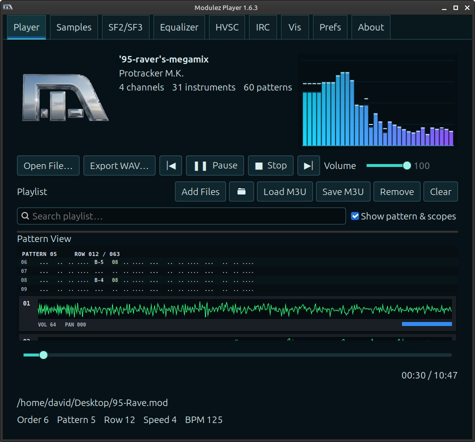

## Features

- **Wavescope Vis tab** with 34 standard visualization modes and projectM / MilkDrop
- **MilkDrop preset library** with 13 bundled starters, multi-file import, persistent user storage, and right-click next/previous/random controls
- **Offline visualizations** fed directly from playback after EQ and volume; rendering pauses when hidden
- **Fullscreen visualizers** with F11, double-click, Escape, and right-click controls
- **Song navigation from the visualizer** with Ctrl+Left/Right and context-menu commands
- **Customizable charcoal theme** with rainbow Background/Highlight Color sliders and brightness
- **Theme-aware dual-color spectrum** on the Player tab
- **Theme-aware IRC interface** with colors that follow the selected player theme
- **Theme-aware equalizer graph** with matching backgrounds, curves, and frequency bars
- 🎵 **Tracker module playback** powered by libxmp
- 🎵 **Additional Amiga music formats** powered by UADE, with libxmp retaining priority for formats supported by both engines
- 🎧 **Regular audio playback** powered by FFmpeg: MP3, WAV, M4A/AAC, Ogg Vorbis, Opus, and FLAC
- 🎵 **Commodore 64 SID playback** powered by libsidplayfp
- 🎹 **MIDI playback** powered by FluidSynth, with user-selectable SF2/SF3 SoundFonts
- 🎼 **SoundFont manager** with multi-file import, folder scanning, live switching, and a startup default
- 🎵 **ZX Spectrum AY/YM playback** through bundled ZXTune, including PT3, AY, VTX, YM, STC, and SQT
- 💾 **Offline WAV export** for all six playback engines, with cancellation and overwrite confirmation; UADE exports until song end by default, with an optional time limit
- 🎚️ **Playback controls** with seeking and track timing
- 📃 **Playlist management** with add, remove, clear, drag-and-drop support, and recursive music-folder importing
- 📃 **High Voltage SID Collection (HVSC) browsing and integrated downloader**
- 🔁 **Automatic track advancement**
- 📂 **M3U playlist loading and saving**
- 📊 **Real-time audio spectrum visualizer** with peak hold
- 🎚️ **10-band equalizer (introduced in 1.3)** with presets, preamp, and a live frequency-response curve
- 🌊 **Channel scopes** for visualizing audio activity
- 🧩 **Pattern viewer** for tracker data
- 🔊 **Sample browser** with waveform visualization, sample details, loop information, and module comments
- 🖥️ **Native GTK3 interface** with SDL2 audio output
- 💬 **Built-in IRC chat** with EsperNet/#modulez preset, TLS, channel tabs, and private messages

## IRC community chat

The **IRC** tab is a simple, classic IRC client integrated into Modulez Player's GTK3
interface. It defaults to EsperNet (`irc.esper.net`, TLS port 6697) and
auto-joins `#modulez` after a successful connection. Change the network,
nickname, and auto-join channel with the **Connect** or **Settings** buttons.

The client has channels, private-message tabs, a user list, and IRC commands
such as `/join`, `/part`, `/nick`, and `/me`. It does not connect until you
click **Connect**. Network settings are saved to
`~/.config/xmp-irc/settings.ini`; no IRC passwords are stored.

The IRC interface follows the selected Modulez Player theme, including
backgrounds, buttons, borders, and other controls. Nicknames and message
types retain their distinct colors for readability.

The parser can be checked using `make check-irc`; that command also performs
a syntax check of the GTK/GIO source files.

## Version 1.7.3

Double-click a sample in the Samples tab to hear it, or open the Pattern tab to play
and loop individual patterns in a larger grid.

[1.7.3 release notes](RELEASE_NOTES_1.7.3.md)

## Version 1.7.2

Player settings now live in `~/.config/modulez-player/`. On upgrade, the player
copies missing settings and imported MilkDrop presets from the old folder.
[1.7.2 release notes](RELEASE_NOTES_1.7.2.md)

## Version 1.7.1

Fixed a GTK theme warning and updated the HVSC waveform when appearance
settings change. [1.7.1 release notes](RELEASE_NOTES_1.7.1.md)

## Version 1.7.0

Version 1.7.0 adds fullscreen Wavescope and MilkDrop, convenient song and preset navigation, and a charcoal default theme with customizable colors and brightness. The Player spectrum retains a colorful two-hue gradient that follows the selected accent.

See the [1.7 release notes](RELEASE_NOTES_1.7.md) for details and compatibility notes.

## Version 1.6.4

Opening a track from the command line, a file manager, or **Open File** now starts playback immediately. The player appends new tracks to the current playlist and reuses the existing entry when you reopen the same path. **Add Files** queues tracks for later.

Version 1.6.3 fixed audio stuttering when **Show pattern & scopes** is enabled.
The pattern view and channel scopes now draw while playback continues.

See the [v1.6.4 release](https://github.com/dasteele-ctrl/xmp-module-player/releases/tag/v1.6.4) or the [v1.6 visualizer release notes](RELEASE_NOTES_1.6.md).

The v1.6.3 Linux x86_64 AppImage passed packaging verification and desktop testing on
Linux Mint 22.3 XFCE. Compatibility on other Linux systems has not yet been verified.
Wavescope is credited to Signal Ridge Labs (MIT), and projectM uses LGPL-2.1;
license notices and source references are included with the visualization assets.

## Download

**[Download Modulez Player v1.7.2 for Linux x86_64](https://github.com/dasteele-ctrl/xmp-module-player/releases/download/v1.7.2/Modulez-Player-v1.7.2-x86_64.AppImage)**

[Release notes and downloads](https://github.com/dasteele-ctrl/xmp-module-player/releases/tag/v1.7.2).

The AppImage includes the application launcher icon.
See [all releases](../../releases) for earlier versions.

### Running the AppImage

1. Download the versioned `Modulez-Player-v1.7.2-x86_64.AppImage` file from Release v1.7.2.
2. Open a terminal in the download folder.
3. Make it executable and launch it:

   ```bash
   chmod +x Modulez-Player-v1.7.2-x86_64.AppImage
   ./Modulez-Player-v1.7.2-x86_64.AppImage
   ```

### Add the player to your application menu

For a menu entry with the player icon, use **AppImageLauncher**, an
integration tool described in the official AppImage documentation.

1. Follow the installation instructions in the
   [official AppImageLauncher project](https://github.com/TheAssassin/AppImageLauncher).
   Choose the package appropriate for your Linux distribution and architecture.
2. Download the Modulez Player AppImage from this project's Releases page.
3. Open the downloaded AppImage. When AppImageLauncher offers the choice,
   select **Integrate and run**.
4. Launch **Modulez Player** from your application menu on future runs.

AppImageLauncher uses the desktop entry and icon already inside the AppImage;
there is no need to extract them or find an icon yourself. By default, it moves
the AppImage to `~/Applications`. Keep that integrated file in place so the
menu entry continues to work.

Desktop integration is optional. You can still run the AppImage directly,
use another integration tool, or create a launcher yourself. See the
[AppImage desktop integration guide](https://docs.appimage.org/user-guide/run-appimages.html#integrating-appimages-into-the-desktop)
for more information.

## Requirements

The 1.6 AppImage includes the playback libraries, UADE core and player data, ZXTune helper, and default MIDI SoundFont with its license. A separate UADE installation or SoundFont download is not needed. Compatibility with Linux distributions other than the development system has not yet been fully tested.

### MIDI and SoundFonts

Standard MIDI files (`.mid`, `.midi`, `.kar`) are rendered directly to the
existing SDL stereo output by **FluidSynth**, using its audio sample clock.
The **SoundFonts** tab manages a library of `.sf2` and `.sf3` file paths.
Add one or many files, scan a folder (including subfolders), or double-click
an entry to switch while MIDI plays. **Set / Clear Default** chooses the font
used automatically on subsequent launches. Removal only removes the list entry,
never the original SoundFont file. Existing single-SoundFont settings are
imported automatically when upgrading. The player also detects common system
SoundFonts if you have not selected one.

On Linux Mint / Ubuntu, build MIDI support with the FluidSynth development
library and a General MIDI SoundFont:

```bash
sudo apt install libfluidsynth-dev fluid-soundfont-gm
make -j4
./modulez-player
```

The 1.6 AppImage bundles **MS Basic.sf3** as its default General MIDI
SoundFont, together with its license. You can still import and select your
own SF2/SF3 banks. A previously saved selection may take priority over the
bundled default. Packaging details are in the
[AppImage README](packaging/appimage/README.md).

MIDI playback and the SoundFont Manager were introduced in **version 1.2**.

### Amiga playback with UADE (introduced in version 1.4.3)

**UADE** adds Amiga music formats that libxmp cannot play. libxmp retains
priority for shared formats; UADE is used as a fallback. Existing dedicated
SID, MIDI, and ZX Spectrum playback remains available.

Open the music file itself, such as `mdat.song`, and keep any companion
sample files, such as `smpl.song`, in the same folder with their original
names. Folder importing recognizes common Amiga prefix and suffix names.
For formats outside that initial filename list, choose **All files** in
Open or Add Files.

UADE supports seeking, pause/resume, playlist navigation, volume, EQ, and
mixed waveform/spectrum visualization. Seeking uses background emulation,
so larger jumps can take time. When no duration is known, the time display
shows `--:--` and the seek bar uses an expanding navigation range rather
than claiming a fixed song length.

WAV export renders from the beginning using an independent decoder. By
default, it continues until UADE reports song end. For looping songs, enable
**Limit to** in the Save dialog and choose 1–3600 seconds. Exports stop at
that limit or song end, whichever comes first. Natural-end mode does not
guarantee automatic loop detection. Cancellation or a failed export leaves
an existing destination file unchanged.

The AppImage includes UADE's runtime and player data. For source builds,
UADE development headers, `libuade.pc`, the installed core/data, and
libbencodetools are required; development and testing used **UADE 3.05**.
See [UADE integration notes](UADE_INTEGRATION.md) for runtime overrides
and diagnostic commands.

### 10-Band Equalizer (introduced in version 1.3)

The integrated **Equalizer** tab provides ten adjustable bands (31 Hz to
16 kHz), a preamp control, an aqua frequency-response graph with a subtle live
spectrum, on/off bypass, and Flat, Rock, Pop, Classical, Jazz, Bass Boost and
Vocal Clarity presets. Moving a slider creates a Custom preset. Changes are
applied to the shared stereo output for tracker modules, UADE, SID, ZX, MIDI, and
regular audio files without any additional audio library. The EQ uses smooth
transitions when changing gains or toggling bypass.

EQ settings are stored in
`~/.config/modulez-player/equalizer.ini` (or the corresponding XDG
configuration directory), so they persist between AppImage upgrades.

The EQ is for **live playback**; exported WAV files remain unchanged. Use the
preamp to leave headroom when boosting multiple frequency bands. The 1.3 theme
also brings the same deep ocean-blue and aqua palette to the other tabs.

To run the standalone DSP regression tests during development:

```bash
make check-eq
```

### ZX Spectrum playback

Modulez Player 1.1 includes native ZX Spectrum playback powered
by ZXTune.

The Linux AppImage bundles the ZXTune playback engine and its required
libraries. Users do not need to install ZXTune, compile libraries, or
download additional components.

For compatibility, ZXTune runs in a separate helper process called
`xmp-zx-helper`. Decoded PCM audio is streamed directly to the main
player's SDL2 audio engine without creating temporary WAV files.

Supported formats include `.pt3`, `.pt2`, `.ay`, `.ym`, `.vtx`, `.stc`,
`.sqt`, `.psg`, and other formats recognized by ZXTune.

Volume, seeking, spectrum visualization, waveform display, and playlist
controls are integrated into the player.

Tracker pattern visualization remains available for supported libxmp
formats, but is not currently available for ZX Spectrum files.

#### Building from source

Developers compiling Modulez Player from source must first build
ZXTune's static libraries:

```bash
make platform=linux system.zlib=1 -C ~/zxtune/apps/zxtune123 -j4
```

Then compile Modulez Player:

```bash
make -j4
./modulez-player
```

The optional legacy `zxtune123` WAV-based fallback is not included
in the distributed AppImage.

## Built With

- [GTK 3](https://www.gtk.org/) — graphical interface
- [SDL 2](https://www.libsdl.org/) — audio output
- [libxmp](https://github.com/libxmp/libxmp) — tracker module playback
- [UADE](https://zakalwe.fi/uade/) — additional Amiga music formats
- [libsidplayfp](https://github.com/libsidplayfp/libsidplayfp) — Commodore 64 SID playback
- [FFmpeg](https://ffmpeg.org/) — decoding regular audio formats
- [ZXTune](https://github.com/vitamin-caig/zxtune) — native ZX Spectrum and chiptune playback
- [FluidSynth](https://www.fluidsynth.org/) — MIDI synthesis with SF2/SF3 SoundFonts

## Project Status

**Current source version: 1.7.3**

Version 1.6 adds Wavescope/projectM visualizations, saved `.milk` preset importing,
right-click preset navigation, preset-collection links, compact tab labels and
Vis-aware AppImage packaging. The About page includes visualization credits.


Version 1.5 rebrands XMP Module Player as **Modulez Player**, with a new
application icon, About title, tray/menu text, desktop entry, and AppImage
filename. Playback features from 1.4.3 are retained.

Version 1.7.2 stores player settings in `~/.config/modulez-player/` under the
standard XDG configuration directory. On upgrade, the player copies missing
settings and imported MilkDrop presets from `~/.config/xmp-module-player/`.
Existing files in the new folder take precedence. The old folder remains
available for earlier releases. IRC uses `~/.config/xmp-irc/`.

The launcher icon is bundled inside the AppImage and is also available in
the repository as [`icons/modulez-player.png`](icons/modulez-player.png).

Version 1.4.3 adds UADE fallback playback, seeking, and WAV export for
additional Amiga music formats. The AppImage bundles UADE's core, libraries,
player data, and the default MIDI SoundFont with its license. The About tab
now lists all six playback engines and the main features.

The 1.5 AppImage was tested locally for playback, engine switching,
seeking, WAV export, and clean exit. Packaging verification checked the
bundled UADE assets and compared the SoundFont and license with the originals.

Version 1.4.2 fixes playlist navigation, makes Play start the first playlist track, and adds recursive folder loading.

Version 1.4.1 adds a high-contrast system tray icon, playback controls,
optional minimize-to-tray behavior, and a more readable track tooltip.

Version 1.4 integrates an IRC client in the player's existing GTK interface.
It includes TLS connections, multiple channels, private-message tabs, and an
EsperNet `#modulez` preset. IRC connections are initiated manually.

This project is actively being developed. Features and compatibility may change as development continues.

## System tray and preferences

Modulez Player shows a tray icon on desktops with a GTK3-compatible notification area.
Click the icon to bring the player back; right-click for playback controls,
current-track information, and **Quit Modulez Player**. The tray icon uses a bright
white version of the Modulez mark for visibility on dark panels. Its excess
transparent margins are cropped so the logo fills the tray icon slot. Previous and
Next in the tray menu move between playlist files, wrapping at either end;
they do not skip positions within a tracker module. If nothing is loaded,
Play in the tray menu starts the first file in the playlist. The tooltip
shows the current track title in bold white text against a charcoal surface.

The **Preferences** tab includes **Minimize to tray when closing Modulez Player**,
enabled by default. When checked, closing the main window keeps the player
running in the tray. Uncheck it to make the close button quit normally.
This choice is saved in `~/.config/modulez-player/preferences.ini`.
If there is no usable tray, closing the window always exits normally.

## Author

**David (DaSteele) Harryman**

## License

Licensing information for the application source

<details>
<summary><strong>View 10 screenshots</strong></summary>

Click a thumbnail to view the full screenshot.

<p>
  <a href="docs/screenshots/1-player.png">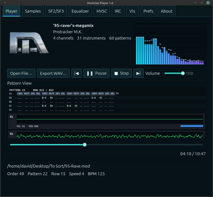</a>
  <a href="docs/screenshots/2-playlist.png">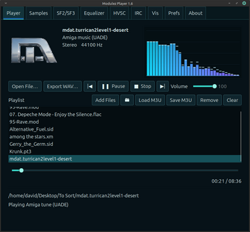</a>
  <a href="docs/screenshots/3-samples.png">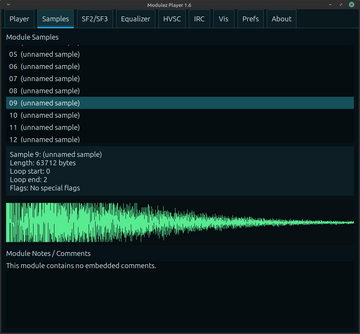</a>
  <a href="docs/screenshots/4-soundfonts.png">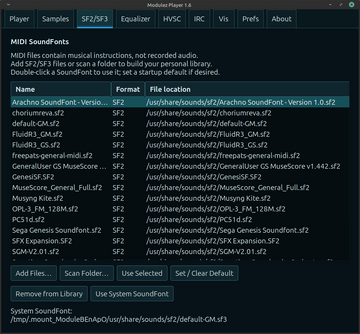</a>
  <a href="docs/screenshots/5-eq.png">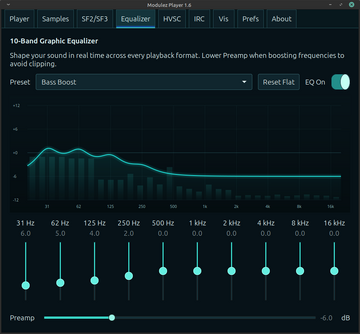</a>
  <a href="docs/screenshots/6-hvsc.png">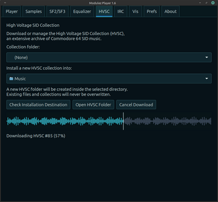</a>
  <a href="docs/screenshots/7-irc.png">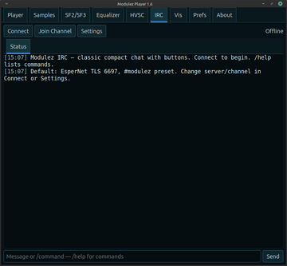</a>
  <a href="docs/screenshots/8-vis.png">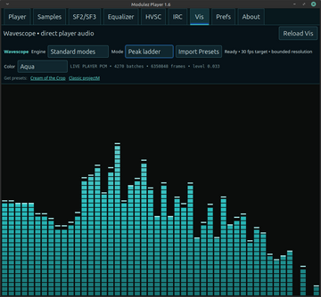</a>
  <a href="docs/screenshots/9-vis.png">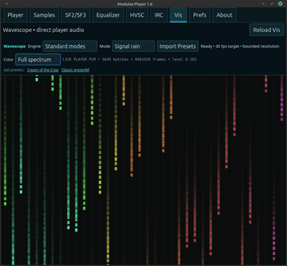</a>
  <a href="docs/screenshots/10-vis.png">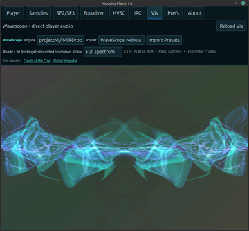</a>
</p>

</details>
