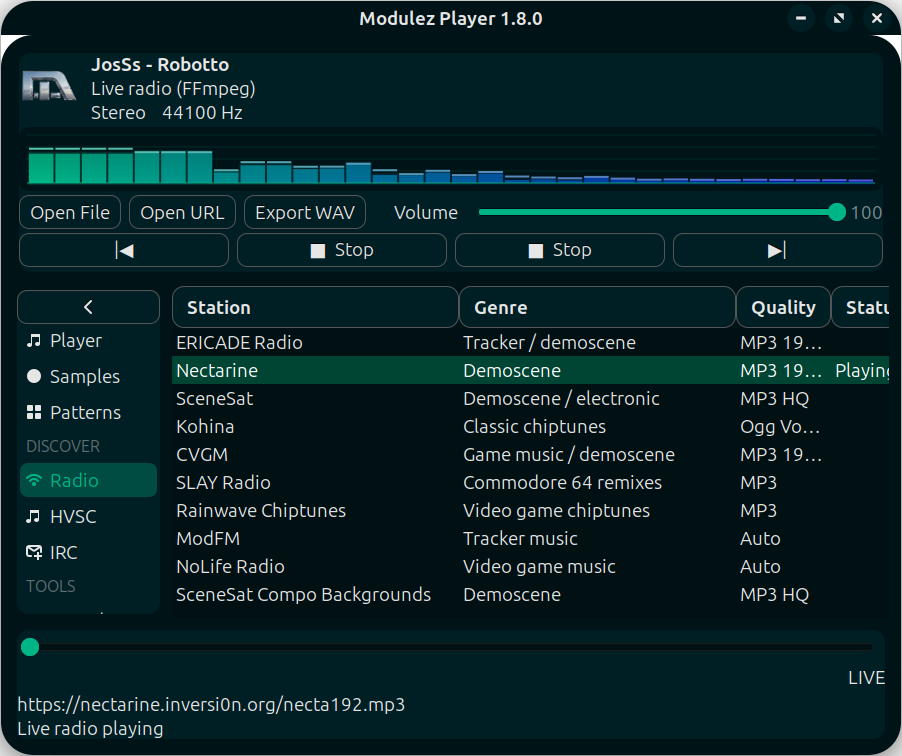

# Modulez Player 1.8.0 — The Streaming Update

Modulez Player brings live internet radio to its classic tracker and chiptune playback experience, together with a modernized desktop interface.

## Internet radio

- Live FFmpeg streaming with station and track metadata when available.
- Ten curated demoscene, tracker, chiptune and retro stations: ERICADE, Nectarine, SceneSat, Kohina, CVGM, SLAY Radio, Rainwave Chiptunes, ModFM, NoLife Radio and SceneSat Compo Backgrounds.
- Worldwide discovery through Radio Browser: search by name, country code and tag, with paginated results and station website links.
- Persistent favorites and editable custom HTTP/HTTPS stations.
- Automatic reconnection after detected stream failures, with retry delays of 2, 4, 8, 16 and up to 30 seconds. The delay resets after 15 seconds of decoded audio.
- Stop, station changes, local playback and application exit cancel retries.
- Live streams share the existing equalizer, volume and visualizer pipeline. Seeking and offline WAV export are intended for local files, not live radio.

## Interface improvements

- Collapsible navigation sidebar and reorganized playback controls.
- Modern rounded main window and theme-aware dialog decorations, with native decoration fallback.
- Full-width spectrum, scrollable content and improved layout.
- Responsive visualizer viewport and theme-aware toolbar controls.

## Linux AppImage

The Linux x86_64 AppImage retains the existing playback engines, WebKit visualizers, UADE runtime, ZXTune helper and bundled SoundFont. Radio discovery adds JSON-GLib and uses libsoup 3. The matching `.AppImage.zsync` supports the built-in updater.

Radio requires an internet connection. Station availability and metadata depend on broadcasters and the Radio Browser directory. Reconnection begins when the decoder detects failure; it does not guarantee immediate detection of every network stall.

## Settings and compatibility

Favorites and custom stations are stored in `~/.config/modulez-player/radio-stations.ini` (or the corresponding XDG configuration directory). Existing player settings remain in place. The development platform is Linux Mint 22.3 XFCE; compatibility on other distributions is not guaranteed.

## Acknowledgments

Thanks to the demoscene, radio station operators, Radio Browser contributors and the open-source projects that make Modulez Player possible.

